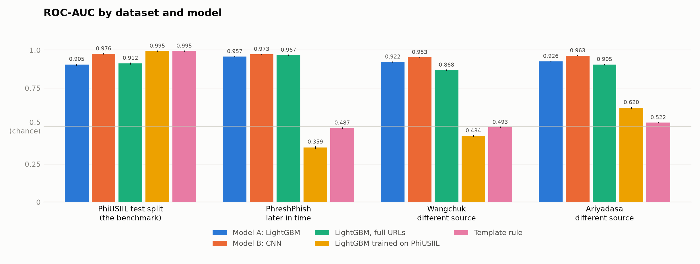
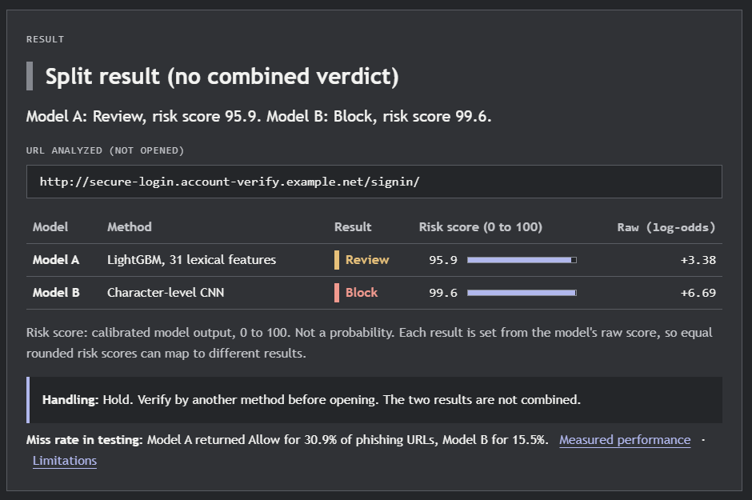

# Phishing URL Detector

*Graduate final project, CYBERSEC 520 (Duke University), by Patrick Markey.*

Two models score the text of a link as phishing or legitimate, in about a
millisecond and without opening it. They were trained on one collector's data
and tested on later data and on two other collectors' data. The point of the
project is to measure honestly how far a URL-only model can be trusted.

**Live demo:** https://x39393902-phishing-url-scorer.hf.space (Hugging Face Docker Space, CPU Basic)

| Test set | Scorer | ROC-AUC | Blocked: phishing caught | Blocked: legitimate flagged | Reviewed or blocked: phishing caught | Reviewed or blocked: legitimate flagged |
|---|---|---|---|---|---|---|
| PhreshPhish, later in time | Model A: LightGBM | 0.957 | 33.5% | 0.07% | 69.1% | 1.15% |
| PhreshPhish, later in time | Model B: character CNN | 0.973 | 55.6% | 0.13% | 84.5% | 1.34% |
| Wangchuk, different source | Model A: LightGBM | 0.922 | 45.5% | 3.26% | 78.3% | 12.54% |
| Wangchuk, different source | Model B: character CNN | 0.953 | 81.5% | 7.66% | 93.7% | 18.98% |
| PhreshPhish, later in time | Baseline: LightGBM trained on PhiUSIIL | 0.359 | 73.5% | 93.72% | not applicable | not applicable |

Adding `www.`, `https` and an ordinary-looking path to a phishing link cut the
share blocked from 33.5% to 2.3% for Model A and from 55.6% to 3.6% for Model B,
so the models are a fast first filter, not a gate (see [limitations](#limitations)).
The last row is the trap this project avoids: a model trained on the popular
PhiUSIIL benchmark, which ranks real links worse than chance (0.5).



**Run the app** (Python 3.11, from the repository root, in a new virtual
environment; the tests need the full one under [Reproduce](#reproduce)):

```powershell
py -3.11 -m venv .venv-app; .venv-app\Scripts\Activate.ps1
pip install -r app/requirements.txt
python app/app.py          # then open http://localhost:7860
```

The page shows each model's result, the URL split into its parts and a copyable
triage note; nothing is looked up and the link is never fetched ([screenshots](docs/screenshots/)).
Defanged input is accepted, and a **Several URLs** tab scores up to 50 lines.

"Blocked" uses a threshold set on validation for a 0.1% false-positive rate.
"Reviewed or blocked" uses one set for 1%, chosen after the test results had
been seen ([design decisions](docs/design_decisions.md), section 6). Results on
the second external dataset (Ariyadasa) and every 95% interval are in
[reports/results.md](reports/results.md).

## How it works

**The idea.** A phishing link has to be judged before anyone clicks it, often
before anyone has reported it. Blocklists only know links that were already
reported, and sandboxes take seconds to minutes per link. This project measures
how much the text of a link alone can tell a defender, instantly, and where that
stops being enough.

**The benchmark trap.** Every legitimate link in the popular PhiUSIIL benchmark
is a bare homepage, so a one-line rule with no learning is right for 99.73% of
it. A model trained there scores 0.995 on its own test split and 0.359 on later
real links. It is kept only as a cautionary baseline.

**Data.**

- **Training:** PhreshPhish, 418,143 links from July 2024 to July 2025. Its
  legitimate links come from real browsing.
- **Validation:** the next six weeks, 76,009 links, used only for calibration
  and thresholds.
- **Tests, each scored once with frozen models:** 50,000 later PhreshPhish links
  (September to December 2025), and two datasets from other collectors, Wangchuk
  (98,085 links) and Ariyadasa (76,169 links).
- **One cleaning pipeline for every dataset:** duplicates and conflicting labels
  are removed, and so is every test link that also appears in training. That
  removed 13,049 Wangchuk phishing links, one in four. The query string is
  removed from every link, because the collector had removed it from legitimate
  links only ([design decisions](docs/design_decisions.md), decision 8).

**Models.**

| | Model A | Model B |
|---|---|---|
| Type | LightGBM, gradient-boosted decision trees | Character-level convolutional neural network (PyTorch, exported to ONNX) |
| Input | 31 measurements of the URL string, such as its length and number of dots | The first 200 characters of the URL |
| Training | 20 Optuna trials with 3-fold cross-validation, then 327 trees | Filters 3, 5 and 7 characters wide, 89,633 weights, early stopping, trained on a GPU |
| Strength | Shows which measurement moved a score | Learns patterns nobody wrote down |
| Weakness | Sees only the measurements it was given | Its reasons are harder to explain |

Both are calibrated with isotonic regression on validation, and each returns
Block, Review or Allow.

**Deployment.** A Gradio app in a Docker container on Hugging Face Spaces, on
CPU only. Both models score a link in about 1 ms, and the app never opens the
link.



## Limitations

- **The models cannot block on their own.** At a 0.1% false-positive rate they
  block 33.5% (Model A) and 55.6% (Model B) of later phishing.
- **Their false-positive rate does not transfer.** It holds on later data from
  the training collector and rises on other collectors' data (the Wangchuk rows
  above).
- **A link edited to look legitimate gets through.** In the training data 92.9%
  of legitimate URLs have a path and 48.4% of phishing URLs do not, so an
  appended path reads as benign.
- **They see only the URL**, without its query string or fragment: no page
  content, no redirects, no domain reputation.
- **Scores are not probabilities.** The training data's class mix was set by when
  the collector gathered each class.

The full list, with numbers, opens [reports/results.md](reports/results.md).

## Reproduce

Requires Python 3.11. The commands are for Windows PowerShell; on macOS or
Linux use `python3.11 -m venv .venv` and `source .venv/bin/activate`.

```powershell
py -3.11 -m venv .venv
.venv\Scripts\Activate.ps1
pip install -r requirements.txt
pytest
```

- If PowerShell refuses to run `Activate.ps1` ("running scripts is disabled"),
  run `Set-ExecutionPolicy -Scope Process Bypass` in the same window first.
- Use a separate environment for the app's `app/requirements.txt`: its pins
  (pandas 3.1.1, for example) differ from this file's, and installing both into
  one environment replaces one set with the other. This environment already
  includes Gradio, so `python app/app.py` also runs here.
- On a fresh clone, `pytest` reports 343 passed and 10 skipped (checked on
  2026-11-23). Eight tests need `data/processed/`, which notebook 01 builds, and
  two need a running copy of the app (`PHISHING_APP_URL=http://localhost:7860`).
  No dataset is downloaded by the tests.

The notebooks run in order. Each calls code in `src/`, explains its decisions and
ends with its conclusion.

| Notebook | What it does |
|---|---|
| `01_data` | Downloads the datasets into `data/` (not committed), cleans them, and checks them against two acceptance gates |
| `02_lgbm` | Trains Model A and two comparison LightGBM models |
| `03_cnn` | Trains Model B and exports it to ONNX (a GPU is used if present) |
| `04_evaluation` | Tests the frozen models; writes `reports/metrics.json` and `reports/results.md` |
| `05_post_hoc` | The three additions decided after the test results had been seen |

```powershell
foreach ($nb in "01_data", "02_lgbm", "03_cnn", "04_evaluation", "05_post_hoc") {
    jupyter nbconvert --to notebook --execute --inplace --ExecutePreprocessor.timeout=7200 "notebooks/$nb.ipynb"
}
python -m src.business     # rewrites reports/business_case.json from reports/metrics.json
```

Notebook 01 downloads the datasets from Hugging Face, Mendeley and UCI (no
account or token needed) and reads only the URL, label, date and row-id
columns.

To check the results without retraining, run only `04_evaluation` and
`05_post_hoc`: they load the frozen models and verify their hashes. LightGBM
retrains exactly; the CNN gave identical scores in two runs on the development
GPU, which is not guaranteed on other hardware.

The app's container:

```powershell
python app/build_space.py
docker build -t phishing-url-scorer build/space
docker run --rm -p 7860:7860 phishing-url-scorer
```

[docs/deployment.md](docs/deployment.md) has the measured latency and the steps
to publish it on Hugging Face Spaces.

## Data sources and licences

| Dataset | Role | Citation | Licence |
|---|---|---|---|
| PhreshPhish | Training, validation, later-in-time test | Dalton et al., "PhreshPhish", Hugging Face dataset `phreshphish/phreshphish`, v1.0.1, read at commit `eca603e0`; paper arXiv:2507.10854. https://huggingface.co/datasets/phreshphish/phreshphish | CC BY 4.0, for anti-phishing research only |
| Wangchuk | Unseen secondary dataset | Wangchuk, T., "Phishing URL dataset", Mendeley Data, v1, published 9 January 2026. https://doi.org/10.17632/3jddhy2f6s.1 | CC BY 4.0 |
| Ariyadasa | Second external check (`index.sql` only) | Ariyadasa, S., Fernando, S., Fernando, S., "Phishing Websites Dataset", Mendeley Data, v1, published 16 November 2021. https://doi.org/10.17632/n96ncsr5g4.1 | CC BY 4.0 |
| PhiUSIIL | Cautionary baseline only | Prasad, A., Chandra, S., "PhiUSIIL Phishing URL Dataset", UCI Machine Learning Repository, 2024 (id 967). https://archive.ics.uci.edu/dataset/967 | CC BY 4.0 |
| Kaitholikkal and B | Read only to date Wangchuk's phishing class | Kaitholikkal, J. K. S., and B, A., "Phishing URL dataset", Mendeley Data, v1, published 2 April 2024. https://doi.org/10.17632/vfszbj9b36.1 | CC BY 4.0 |

Only URL strings, labels, dates and row ids are read. No dataset is
redistributed here.

## Layout

| Path | Contents |
|---|---|
| `src/` | `features.py` (the one feature module, used in training and in the app), `data.py`, `pipeline.py`, `audit.py`, `models.py`, `evaluate.py`, `mutate.py`, `posthoc.py`, `report.py`, `business.py`, `style.py` |
| `notebooks/` | `01_data` to `05_post_hoc`, run in order |
| `models/` | the frozen models, calibrators, thresholds and their hashes |
| `reports/` | data audits, `metrics.json`, `results.md`, `latency.json`, `business_case.json`, `figures/` |
| `app/` | the Gradio app, its pinned requirements, `Dockerfile`, Space card, bundle and latency scripts |
| `frozen/` | the ids of the 50,000-row evaluation sample |
| `tests/` | pytest tests for `src/`, the app and the documents |
| `docs/` | the documents below |

Labels everywhere: 1 = phishing, 0 = legitimate.

## Documents

- [Results](reports/results.md): every number, opening with what the models cannot be trusted to do
- [Problem and threat model](docs/problem_and_threat_model.md)
- [Design decisions](docs/design_decisions.md): what changed, when, and on what evidence
- [Deployment](docs/deployment.md)

## Use of generative AI

This project was built with generative AI, cited as the course requires: Claude
for research and planning, ChatGPT for a survey of datasets, and Claude Code for
the code, tests, notebooks and documents, all reviewed by the author.
[docs/ai_usage.md](docs/ai_usage.md) describes how each tool was used and how its
output was checked.
