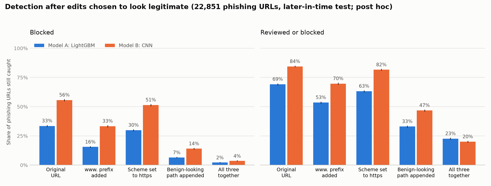
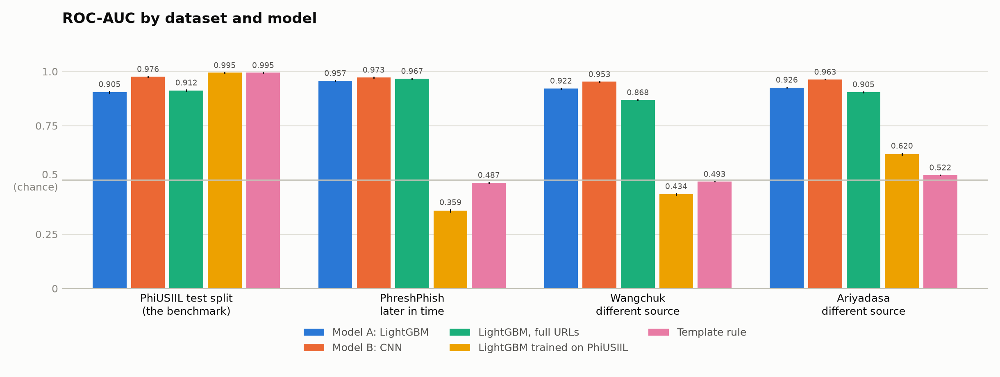
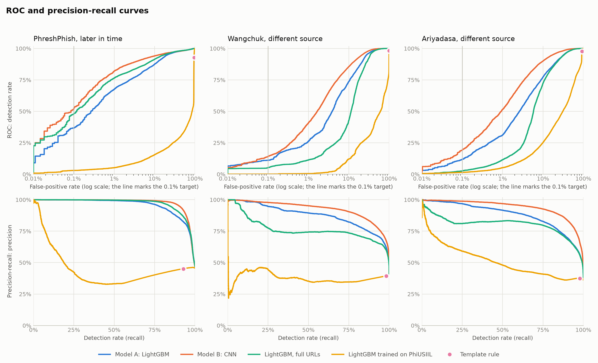
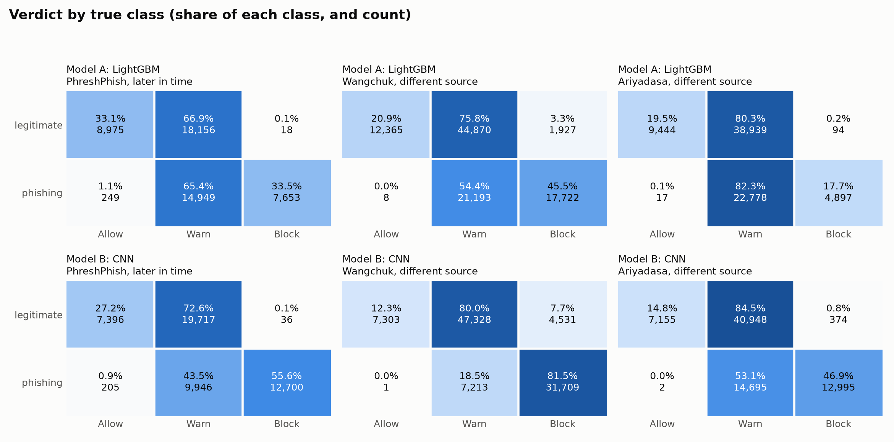
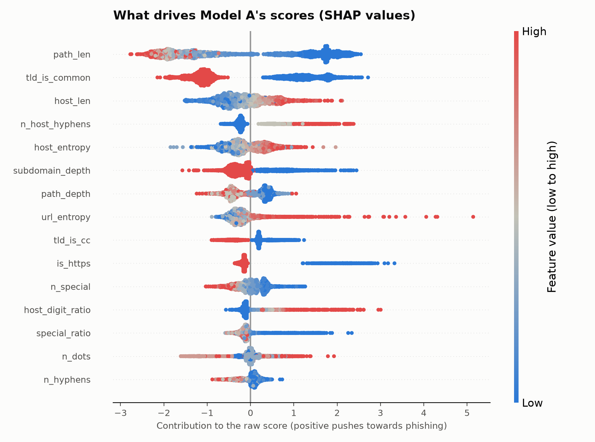
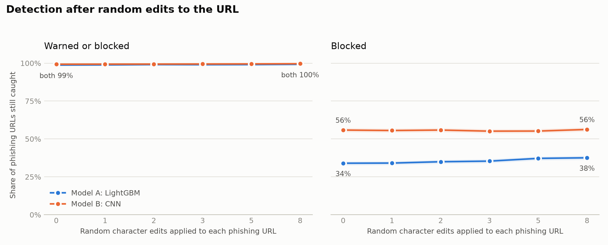

# Results

Generated from `reports/metrics.json` by `src/report.py`. Every number below is read from that file. Intervals in brackets are 95% bootstrap intervals. Full tables and charts are in `notebooks/04_evaluation.ipynb`.

## What these models cannot be trusted to do

Read this section before any score. The models rank URLs far better than chance, and far better than the baselines, but they are not a control that can be left to act on its own.

1. **They cannot be left to block on their own.** The block threshold was set on validation to flag at most 0.1% of legitimate URLs. On later data it blocks 33.5% of phishing (Model A) and 55.6% (Model B). The rest gets a warning at most.
2. **Their false-positive rate holds on later data from the same collector and breaks on other collectors' data.** The block threshold flags 0.07% (Model A) and 0.13% (Model B) of legitimate URLs on later PhreshPhish data, close to the 0.1% target. On Wangchuk it flags 3.26% and 7.66% of presumed-benign URLs, and on Ariyadasa 0.19% and 0.77%. On Wangchuk the errors are concentrated: 75% of Model A's wrongly blocked URLs, and 51% of Model B's, sit on ten registered domains.
3. **Their warning band is too wide to act on.** The warn threshold was set to catch 95% of validation phishing. On later data it warns on or blocks 66.9% of legitimate URLs for Model A and 72.8% for Model B, while catching 98.9% and 99.1% of phishing. Model A warns on 100.0% of legitimate bare homepages. A warning shown on that many ordinary links teaches people to ignore it. The warn point was the pre-specified target. It was already this wide on validation, where it flagged 65.9% and 71.5% of legitimate URLs, so it is a target that proved unreachable at a usable false-positive rate for a model that sees only the URL. A review point at a 1% validation false-positive rate was added afterwards; see *Additions made after the test results were seen*.
4. **Their quality swings from one period to the next, and cross-validation hid that.** Cross-validation inside the training period gave Model A a PR-AUC of 0.987. On the six weeks after the training period (validation) its PR-AUC was 0.834 and its ROC-AUC 0.890; on the three months after that (the evaluation sample) its ROC-AUC was 0.957. Random folds put URLs from the same campaigns and weeks on both sides of each split. (PR-AUC also depends on the class mix, which differs between these sets; ROC-AUC does not.)
5. **They are weaker on registered domains they have not seen.** Model A's ROC-AUC on seen against unseen domains is 0.970 against 0.923 on later data, 0.946 against 0.841 on Wangchuk and 0.980 against 0.882 on Ariyadasa. Its block threshold catches 45.4% against 24.0% of phishing on later data. Model B shows the same pattern (0.979 against 0.952; 66.1% against 47.2% blocked). Part of what looks like detection is recognition of hosting platforms from the training data.
6. **Random edits did not lower detection, and that is not evidence of robustness.** After eight random character edits the share of phishing URLs blocked went from 34.0% to 37.6% for Model A and from 55.9% to 56.3% for Model B. Random edits make a URL look more random, which these models already treat as suspicious. The test says nothing about edits chosen to look legitimate. The feature Model A leans on most is `path_len`, which an attacker controls completely, and an attacker who can query the scorer can search for whatever passes. A test with edits chosen to look legitimate was added afterwards: with a `www.` prefix, `https` and a benign-looking path together, the share blocked went from 33.5% to 2.3% for Model A and from 55.6% to 3.6% for Model B (see *Additions made after the test results were seen*).
7. **Their scores are not probabilities.** The calibrator was fitted on validation data that is 25% phishing because of when the collector gathered each class. No legitimate rows exist for November 2024 to April 2025. A calibrated score of 0.9 does not mean a 90% chance of phishing.
8. **They see only the URL string, without its query string.** They cannot detect phishing hosted on a legitimate domain from the page content, cannot follow a redirect or a shortener, and ignore anything after `?` or `#`.
9. **Nothing here measures performance on live traffic.** Every test set is 36% to 46% phishing. At a 1% phishing rate, Model A's block verdict would be right 83.6% of the time on the later data and its warn verdict 1.5%; at 0.1%, 33.6% and 0.1%.

## What they can do

- **Rank URLs usefully.** ROC-AUC on later data is 0.957 for Model A and 0.973 for Model B. On the two datasets from other collectors it is 0.922 and 0.926 for Model A, and 0.953 and 0.963 for Model B.
- **Beat the benchmark-trained baseline everywhere outside the benchmark.** A LightGBM trained on PhiUSIIL scores 0.9946 on PhiUSIIL's own test split and 0.359, 0.434 and 0.620 on the three tests here (0.5 is chance).
- **Score a URL in about 1.0 ms, without fetching it.** That is the median for both models inside the app's container over 100 URLs (1.5 ms at the 95th percentile). The feature breakdown the app shows takes a further 27 ms, and a full request to the app took 76 ms (80 ms at the 95th percentile) on the development machine (`reports/latency.json`). That speed is what lets a scorer like this sit in front of slower checks as one signal among several.

## Headline table

| Test set | Scorer | ROC-AUC | PR-AUC | Detection at 0.1% FPR | FPR at 95% detection | Block: detection | Block: FPR | Warn: detection | Warn: FPR | Warn: precision | Warn: F1 |
|---|---|---|---|---|---|---|---|---|---|---|---|
| PhreshPhish, later in time | Model A: LightGBM | 0.957 (0.955-0.959) | 0.957 (0.956-0.959) | 36.8% (34.1-40.1) | 20.9% (19.9-21.9) | 33.5% (32.9-34.1) | 0.07% (0.04-0.10) | 98.9% (98.8-99.0) | 66.9% (66.3-67.5) | 55.4% (55.0-55.9) | 0.710 (0.707-0.715) |
| PhreshPhish, later in time | Model B: character CNN | 0.973 (0.971-0.974) | 0.976 (0.975-0.977) | 52.7% (48.5-57.6) | 13.0% (11.9-14.3) | 55.6% (55.0-56.2) | 0.13% (0.09-0.18) | 99.1% (99.0-99.2) | 72.8% (72.2-73.3) | 53.4% (53.0-53.9) | 0.694 (0.690-0.698) |
| PhreshPhish, later in time | Comparison: LightGBM on full URLs | 0.967 (0.965-0.968) | 0.969 (0.967-0.970) | 48.4% (41.5-53.1) | 17.5% (16.3-18.4) | 50.1% (49.5-50.7) | 0.12% (0.08-0.16) | 98.9% (98.8-99.1) | 67.1% (66.5-67.6) | 55.4% (54.9-55.9) | 0.710 (0.706-0.714) |
| PhreshPhish, later in time | Baseline: LightGBM trained on PhiUSIIL | 0.359 (0.353-0.364) | 0.451 (0.445-0.457) | 3.0% (2.7-3.3) | 95.3% (95.0-95.5) | 73.5% (73.0-74.1) | 93.72% (93.46-94.00) | 76.7% (76.1-77.2) | 93.8% (93.5-94.1) | 40.8% (40.3-41.2) | 0.532 (0.528-0.537) |
| PhreshPhish, later in time | Baseline: one-line template rule | 0.487 (0.485-0.489) | 0.451 (0.446-0.455) | 0.0% (0.0-0.0) | 100.0% (100.0-100.0) | 92.8% (92.5-93.2) | 95.41% (95.18-95.65) | 92.8% (92.5-93.2) | 95.4% (95.2-95.6) | 45.0% (44.6-45.5) | 0.606 (0.602-0.611) |
| Wangchuk, different source | Model A: LightGBM | 0.922 (0.921-0.924) | 0.876 (0.873-0.879) | 11.1% (10.7-12.0) | 27.6% (27.2-28.3) | 45.5% (45.0-46.0) | 3.26% (3.11-3.40) | 100.0% (100.0-100.0) | 79.1% (78.8-79.4) | 45.4% (45.1-45.8) | 0.624 (0.621-0.628) |
| Wangchuk, different source | Model B: character CNN | 0.953 (0.952-0.954) | 0.925 (0.923-0.927) | 14.2% (12.7-15.6) | 21.5% (20.9-22.1) | 81.5% (81.1-81.8) | 7.66% (7.46-7.88) | 100.0% (100.0-100.0) | 87.7% (87.4-87.9) | 42.9% (42.6-43.2) | 0.600 (0.597-0.603) |
| Wangchuk, different source | Comparison: LightGBM on full URLs | 0.868 (0.866-0.870) | 0.763 (0.758-0.767) | 5.3% (4.7-6.3) | 34.1% (33.7-34.5) | 48.2% (47.7-48.8) | 11.05% (10.81-11.31) | 100.0% (100.0-100.0) | 80.0% (79.7-80.4) | 45.1% (44.8-45.5) | 0.622 (0.619-0.625) |
| Wangchuk, different source | Baseline: LightGBM trained on PhiUSIIL | 0.434 (0.430-0.438) | 0.379 (0.375-0.383) | 0.1% (0.1-0.1) | 99.2% (99.2-99.3) | 86.9% (86.5-87.2) | 99.02% (98.95-99.10) | 90.1% (89.7-90.4) | 99.1% (99.0-99.1) | 37.4% (37.1-37.7) | 0.529 (0.526-0.532) |
| Wangchuk, different source | Baseline: one-line template rule | 0.493 (0.492-0.494) | 0.394 (0.391-0.397) | 0.0% (0.0-0.0) | 99.6% (99.5-99.6) | 98.2% (98.1-98.3) | 99.58% (99.53-99.63) | 98.2% (98.1-98.3) | 99.6% (99.5-99.6) | 39.4% (39.1-39.7) | 0.562 (0.559-0.565) |
| Ariyadasa, different source | Model A: LightGBM | 0.926 (0.924-0.928) | 0.878 (0.874-0.882) | 11.9% (10.5-13.7) | 32.5% (31.7-33.2) | 17.7% (17.2-18.1) | 0.19% (0.15-0.23) | 99.9% (99.9-100.0) | 80.5% (80.2-80.9) | 41.5% (41.1-41.9) | 0.586 (0.583-0.590) |
| Ariyadasa, different source | Model B: character CNN | 0.963 (0.962-0.965) | 0.938 (0.936-0.941) | 19.3% (15.6-21.9) | 17.5% (16.7-18.1) | 46.9% (46.3-47.5) | 0.77% (0.69-0.85) | 100.0% (100.0-100.0) | 85.2% (84.9-85.5) | 40.1% (39.8-40.5) | 0.573 (0.569-0.576) |
| Ariyadasa, different source | Comparison: LightGBM on full URLs | 0.905 (0.903-0.907) | 0.801 (0.796-0.807) | 2.7% (2.2-3.3) | 33.4% (32.6-34.2) | 29.1% (28.6-29.7) | 3.75% (3.59-3.92) | 99.9% (99.9-100.0) | 80.8% (80.5-81.2) | 41.4% (41.0-41.8) | 0.585 (0.582-0.589) |
| Ariyadasa, different source | Baseline: LightGBM trained on PhiUSIIL | 0.620 (0.615-0.624) | 0.511 (0.505-0.518) | 1.5% (1.3-1.7) | 91.1% (90.9-91.4) | 93.1% (92.8-93.4) | 90.98% (90.73-91.24) | 94.3% (94.1-94.6) | 91.1% (90.8-91.3) | 37.2% (36.8-37.5) | 0.533 (0.529-0.537) |
| Ariyadasa, different source | Baseline: one-line template rule | 0.522 (0.521-0.524) | 0.374 (0.371-0.378) | 0.0% (0.0-0.0) | 93.3% (93.1-93.5) | 97.8% (97.6-97.9) | 93.28% (93.06-93.49) | 97.8% (97.6-97.9) | 93.3% (93.1-93.5) | 37.5% (37.1-37.8) | 0.542 (0.538-0.545) |

- *Detection at 0.1% FPR* and *FPR at 95% detection* are read off each test set's own curve: the best that test set allows. The *Block* and *Warn* columns use the thresholds frozen on validation, which is what a deployed system would actually do.
- *Warn* means warned on or blocked. Precision and F1 are at the class mix of the test set, not of real traffic.
- The template rule has one operating point, so its Block and Warn columns are the same.
- The Warn point is the pre-specified target (catch 95% of phishing). This table is as it was written before the additions under *Additions made after the test results were seen*, which include a review point at a 1% validation false-positive rate.

Rows per test set: PhreshPhish, later in time: 50,000 (27,149 legitimate or presumed benign, 22,851 phishing); Wangchuk, different source: 98,085 (59,162 legitimate or presumed benign, 38,923 phishing); Ariyadasa, different source: 76,169 (48,477 legitimate or presumed benign, 27,692 phishing).

## The benchmark trap

| ROC-AUC | PhiUSIIL test split | PhreshPhish, later in time | Wangchuk, different source | Ariyadasa, different source |
|---|---|---|---|---|
| Baseline: LightGBM trained on PhiUSIIL | 0.995 (0.994-0.995) | 0.359 (0.353-0.364) | 0.434 (0.430-0.438) | 0.620 (0.615-0.624) |
| Baseline: one-line template rule | 0.995 (0.994-0.995) | 0.487 (0.485-0.489) | 0.493 (0.492-0.494) | 0.522 (0.521-0.524) |
| Model A: LightGBM | 0.905 (0.901-0.908) | 0.957 (0.955-0.959) | 0.922 (0.921-0.924) | 0.926 (0.924-0.928) |
| Model B: character CNN | 0.976 (0.975-0.978) | 0.973 (0.971-0.974) | 0.953 (0.952-0.954) | 0.963 (0.962-0.965) |

Every legitimate PhiUSIIL URL is `https://www.<host>/`. A model trained there, and a one-line rule with no learning, both look finished on PhiUSIIL's own test split. Off the benchmark the PhiUSIIL-trained model ranks URLs worse than chance on 2 of the 3 tests (0.5 is chance), because it learned that a path means phishing and real data says the opposite. The one-line rule sits at chance everywhere else.

## The query-string artefact

The PhreshPhish collector removed query parameters from legitimate URLs only (paper, Appendix A.2). The comparison model was trained on the same rows as Model A with the query string kept.

| Test set | ROC-AUC, Model A (query removed) | ROC-AUC, comparison (query kept) | Legitimate URLs that had a query | Flagged by Model A | Flagged by comparison | Blocked by Model A | Blocked by comparison |
|---|---|---|---|---|---|---|---|
| PhreshPhish, later in time | 0.957 (0.955-0.959) | 0.967 (0.965-0.968) | 17 | 100.0% (100.0-100.0) | 100.0% (100.0-100.0) | 0.00% (0.00-0.00) | 82.35% (61.54-100.00) |
| Wangchuk, different source | 0.922 (0.921-0.924) | 0.868 (0.866-0.870) | 5,778 | 84.1% (83.1-85.0) | 100.0% (100.0-100.0) | 3.63% (3.16-4.11) | 86.97% (86.11-87.78) |
| Ariyadasa, different source | 0.926 (0.924-0.928) | 0.905 (0.903-0.907) | 2,084 | 89.6% (88.3-90.9) | 100.0% (100.0-100.0) | 0.24% (0.05-0.47) | 82.92% (81.40-84.46) |

"Flagged" means warned on or blocked. The last four columns cover only legitimate (or presumed-benign) URLs whose original form had a query string. PhreshPhish has almost none, so read those columns on the external datasets.

## Credibility splits

Each result is split three ways. A model worth trusting should hold up in both halves.

### Bare homepage versus a URL with a path

| Test set | Model | Subgroup | Legitimate | Phishing | ROC-AUC | Block: detection | Block: FPR | Warn: detection | Warn: FPR |
|---|---|---|---|---|---|---|---|---|---|
| PhreshPhish, later in time | Model A (LightGBM) | bare homepage | 2,479 | 14,289 | 0.889 (0.883-0.894) | 43.6% (42.8-44.4) | 0.52% (0.28-0.83) | 100.0% (100.0-100.0) | 100.0% (100.0-100.0) |
| PhreshPhish, later in time | Model A (LightGBM) | has a path | 24,670 | 8,562 | 0.935 (0.932-0.939) | 16.6% (15.8-17.4) | 0.02% (0.00-0.04) | 97.1% (96.7-97.5) | 63.6% (63.0-64.2) |
| PhreshPhish, later in time | Model B (character CNN) | bare homepage | 2,479 | 14,289 | 0.971 (0.968-0.974) | 58.8% (58.0-59.7) | 0.44% (0.20-0.72) | 100.0% (100.0-100.0) | 99.6% (99.3-99.8) |
| PhreshPhish, later in time | Model B (character CNN) | has a path | 24,670 | 8,562 | 0.946 (0.942-0.949) | 50.2% (49.1-51.2) | 0.10% (0.06-0.15) | 97.6% (97.3-97.9) | 70.1% (69.5-70.6) |
| Wangchuk, different source | Model A (LightGBM) | bare homepage | 1,805 | 17,406 | 0.774 (0.762-0.784) | 49.9% (49.1-50.7) | 11.63% (10.18-13.17) | 100.0% (100.0-100.0) | 100.0% (100.0-100.0) |
| Wangchuk, different source | Model A (LightGBM) | has a path | 57,357 | 21,517 | 0.917 (0.915-0.919) | 42.0% (41.3-42.6) | 2.99% (2.85-3.13) | 100.0% (99.9-100.0) | 78.4% (78.1-78.8) |
| Wangchuk, different source | Model B (character CNN) | bare homepage | 1,805 | 17,406 | 0.864 (0.855-0.873) | 82.9% (82.4-83.5) | 23.88% (22.04-25.84) | 100.0% (100.0-100.0) | 99.8% (99.6-100.0) |
| Wangchuk, different source | Model B (character CNN) | has a path | 57,357 | 21,517 | 0.954 (0.953-0.956) | 80.3% (79.8-80.8) | 7.15% (6.95-7.37) | 100.0% (100.0-100.0) | 87.3% (87.0-87.5) |
| Ariyadasa, different source | Model A (LightGBM) | bare homepage | 6,782 | 8,052 | 0.880 (0.875-0.886) | 30.4% (29.4-31.4) | 1.14% (0.89-1.40) | 100.0% (100.0-100.0) | 100.0% (100.0-100.0) |
| Ariyadasa, different source | Model A (LightGBM) | has a path | 41,695 | 19,640 | 0.939 (0.937-0.941) | 12.5% (12.0-12.9) | 0.04% (0.02-0.06) | 99.9% (99.9-100.0) | 77.3% (77.0-77.7) |
| Ariyadasa, different source | Model B (character CNN) | bare homepage | 6,782 | 8,052 | 0.942 (0.939-0.946) | 60.5% (59.4-61.5) | 2.49% (2.13-2.89) | 100.0% (100.0-100.0) | 99.8% (99.7-99.9) |
| Ariyadasa, different source | Model B (character CNN) | has a path | 41,695 | 19,640 | 0.968 (0.967-0.970) | 41.4% (40.6-42.1) | 0.49% (0.42-0.56) | 100.0% (100.0-100.0) | 82.9% (82.5-83.2) |

### Registered domain seen in training versus unseen

| Test set | Model | Subgroup | Legitimate | Phishing | ROC-AUC | Block: detection | Block: FPR | Warn: detection | Warn: FPR |
|---|---|---|---|---|---|---|---|---|---|
| PhreshPhish, later in time | Model A (LightGBM) | seen in training | 18,586 | 10,163 | 0.970 (0.968-0.973) | 45.4% (44.4-46.3) | 0.04% (0.02-0.08) | 98.4% (98.2-98.7) | 58.9% (58.2-59.6) |
| PhreshPhish, later in time | Model A (LightGBM) | unseen in training | 8,563 | 12,688 | 0.923 (0.920-0.927) | 24.0% (23.2-24.7) | 0.12% (0.05-0.20) | 99.3% (99.1-99.4) | 84.4% (83.5-85.1) |
| PhreshPhish, later in time | Model B (character CNN) | seen in training | 18,586 | 10,163 | 0.979 (0.977-0.981) | 66.1% (65.1-67.0) | 0.10% (0.06-0.15) | 98.8% (98.6-99.0) | 67.0% (66.3-67.6) |
| PhreshPhish, later in time | Model B (character CNN) | unseen in training | 8,563 | 12,688 | 0.952 (0.949-0.955) | 47.2% (46.3-48.0) | 0.20% (0.11-0.29) | 99.4% (99.2-99.5) | 85.3% (84.5-86.0) |
| Wangchuk, different source | Model A (LightGBM) | seen in training | 38,770 | 29,186 | 0.946 (0.944-0.947) | 56.4% (55.8-56.9) | 3.85% (3.65-4.04) | 100.0% (100.0-100.0) | 76.4% (76.0-76.8) |
| Wangchuk, different source | Model A (LightGBM) | unseen in training | 20,392 | 9,737 | 0.841 (0.836-0.845) | 13.0% (12.4-13.7) | 2.12% (1.91-2.31) | 99.9% (99.9-100.0) | 84.3% (83.7-84.8) |
| Wangchuk, different source | Model B (character CNN) | seen in training | 38,770 | 29,186 | 0.972 (0.971-0.973) | 92.2% (91.9-92.5) | 8.17% (7.92-8.44) | 100.0% (100.0-100.0) | 85.1% (84.8-85.5) |
| Wangchuk, different source | Model B (character CNN) | unseen in training | 20,392 | 9,737 | 0.879 (0.875-0.883) | 49.3% (48.3-50.2) | 6.69% (6.32-7.02) | 100.0% (100.0-100.0) | 92.5% (92.1-92.8) |
| Ariyadasa, different source | Model A (LightGBM) | seen in training | 22,316 | 5,882 | 0.980 (0.978-0.981) | 33.5% (32.2-34.6) | 0.04% (0.02-0.07) | 99.9% (99.9-100.0) | 71.9% (71.4-72.5) |
| Ariyadasa, different source | Model A (LightGBM) | unseen in training | 26,161 | 21,810 | 0.882 (0.879-0.885) | 13.4% (13.0-13.9) | 0.32% (0.26-0.39) | 99.9% (99.9-100.0) | 87.8% (87.4-88.2) |
| Ariyadasa, different source | Model B (character CNN) | seen in training | 22,316 | 5,882 | 0.992 (0.991-0.993) | 77.1% (76.0-78.1) | 0.43% (0.35-0.51) | 100.0% (99.9-100.0) | 77.7% (77.1-78.3) |
| Ariyadasa, different source | Model B (character CNN) | unseen in training | 26,161 | 21,810 | 0.940 (0.938-0.942) | 38.8% (38.1-39.4) | 1.06% (0.94-1.20) | 100.0% (100.0-100.0) | 91.7% (91.3-92.0) |

### Original URL had a query string versus not

| Test set | Model | Subgroup | Legitimate | Phishing | ROC-AUC | Block: detection | Block: FPR | Warn: detection | Warn: FPR |
|---|---|---|---|---|---|---|---|---|---|
| PhreshPhish, later in time | Model A (LightGBM) | had a query string | 17 | 5,476 | 0.974 (0.959-0.986) | 20.2% (19.1-21.3) | 0.00% (0.00-0.00) | 99.5% (99.2-99.6) | 100.0% (100.0-100.0) |
| PhreshPhish, later in time | Model A (LightGBM) | no query string | 27,132 | 17,375 | 0.958 (0.956-0.960) | 37.7% (37.0-38.4) | 0.07% (0.04-0.10) | 98.7% (98.6-98.9) | 66.9% (66.3-67.5) |
| PhreshPhish, later in time | Model B (character CNN) | had a query string | 17 | 5,476 | 0.973 (0.960-0.984) | 44.1% (42.8-45.4) | 0.00% (0.00-0.00) | 99.8% (99.7-99.9) | 100.0% (100.0-100.0) |
| PhreshPhish, later in time | Model B (character CNN) | no query string | 27,132 | 17,375 | 0.970 (0.968-0.972) | 59.2% (58.5-59.9) | 0.13% (0.09-0.18) | 98.9% (98.7-99.0) | 72.7% (72.2-73.3) |
| Wangchuk, different source | Model A (LightGBM) | had a query string | 5,778 | 3,771 | 0.935 (0.930-0.939) | 58.3% (56.7-59.8) | 3.63% (3.16-4.11) | 99.9% (99.9-100.0) | 84.1% (83.1-85.0) |
| Wangchuk, different source | Model A (LightGBM) | no query string | 53,384 | 35,152 | 0.921 (0.919-0.922) | 44.2% (43.6-44.7) | 3.22% (3.06-3.37) | 100.0% (100.0-100.0) | 78.6% (78.2-78.9) |
| Wangchuk, different source | Model B (character CNN) | had a query string | 5,778 | 3,771 | 0.954 (0.950-0.957) | 79.6% (78.3-80.8) | 7.18% (6.53-7.87) | 100.0% (100.0-100.0) | 89.4% (88.6-90.2) |
| Wangchuk, different source | Model B (character CNN) | no query string | 53,384 | 35,152 | 0.953 (0.952-0.954) | 81.7% (81.3-82.0) | 7.71% (7.50-7.95) | 100.0% (100.0-100.0) | 87.5% (87.2-87.8) |
| Ariyadasa, different source | Model A (LightGBM) | had a query string | 2,084 | 4,188 | 0.894 (0.885-0.902) | 12.7% (11.7-13.6) | 0.24% (0.05-0.47) | 99.9% (99.9-100.0) | 89.6% (88.3-90.9) |
| Ariyadasa, different source | Model A (LightGBM) | no query string | 46,393 | 23,504 | 0.928 (0.926-0.930) | 18.6% (18.1-19.1) | 0.19% (0.15-0.23) | 99.9% (99.9-100.0) | 80.1% (79.7-80.5) |
| Ariyadasa, different source | Model B (character CNN) | had a query string | 2,084 | 4,188 | 0.941 (0.935-0.947) | 48.1% (46.6-49.6) | 1.44% (0.95-2.00) | 100.0% (99.9-100.0) | 94.7% (93.6-95.7) |
| Ariyadasa, different source | Model B (character CNN) | no query string | 46,393 | 23,504 | 0.964 (0.963-0.966) | 46.7% (46.0-47.4) | 0.74% (0.66-0.82) | 100.0% (100.0-100.0) | 84.8% (84.5-85.1) |

"Seen in training" means the registered domain occurs anywhere in the PhreshPhish training or validation data, under either label. In PhreshPhish almost no legitimate URL had a query string, so that subgroup's false-positive rates rest on very few rows.

## Precision at realistic phishing rates

| Test set | Model | Block: as tested | Block: 1% phishing | Block: 0.1% phishing | Warn: as tested | Warn: 1% phishing | Warn: 0.1% phishing |
|---|---|---|---|---|---|---|---|
| PhreshPhish, later in time | Model A (LightGBM) | 99.8% (99.7-99.9) | 83.6% (77.8-90.1) | 33.6% (25.7-47.5) | 55.4% (55.0-55.9) | 1.5% (1.5-1.5) | 0.1% (0.1-0.1) |
| PhreshPhish, later in time | Model B (character CNN) | 99.7% (99.6-99.8) | 80.9% (75.8-85.9) | 29.6% (23.7-37.6) | 53.4% (53.0-53.9) | 1.4% (1.3-1.4) | 0.1% (0.1-0.1) |
| Wangchuk, different source | Model A (LightGBM) | 90.2% (89.8-90.6) | 12.4% (11.9-12.9) | 1.4% (1.3-1.4) | 45.4% (45.1-45.8) | 1.3% (1.3-1.3) | 0.1% (0.1-0.1) |
| Wangchuk, different source | Model B (character CNN) | 87.5% (87.2-87.8) | 9.7% (9.5-9.9) | 1.1% (1.0-1.1) | 42.9% (42.6-43.2) | 1.1% (1.1-1.1) | 0.1% (0.1-0.1) |
| Ariyadasa, different source | Model A (LightGBM) | 98.1% (97.8-98.5) | 47.9% (43.5-53.4) | 8.4% (7.1-10.2) | 41.5% (41.1-41.9) | 1.2% (1.2-1.2) | 0.1% (0.1-0.1) |
| Ariyadasa, different source | Model B (character CNN) | 97.2% (96.9-97.5) | 38.1% (35.6-40.7) | 5.7% (5.2-6.4) | 40.1% (39.8-40.5) | 1.2% (1.2-1.2) | 0.1% (0.1-0.1) |

Computed from the measured detection and false-positive rates: of the URLs flagged, the share that would be phishing if phishing were 1% or 0.1% of all URLs.

## External datasets: false positives per URL and per registered domain

| Dataset | Model | Threshold | Presumed-benign URLs | Registered domains | FPR per URL | FPR per domain | Domains with a false positive | False positives in the 10 worst domains |
|---|---|---|---|---|---|---|---|---|
| Wangchuk, different source | Model A (LightGBM) | block | 59,162 | 547 | 3.26% (1.73-4.89) | 2.22% (1.40-3.14) | 66 | 75% |
| Wangchuk, different source | Model A (LightGBM) | warn | 59,162 | 547 | 79.10% (75.66-82.37) | 84.87% (82.68-86.86) | 547 | 6% |
| Wangchuk, different source | Model B (character CNN) | block | 59,162 | 547 | 7.66% (5.37-10.15) | 7.75% (6.28-9.43) | 208 | 51% |
| Wangchuk, different source | Model B (character CNN) | warn | 59,162 | 547 | 87.66% (84.83-90.18) | 91.75% (90.11-93.29) | 547 | 6% |
| Ariyadasa, different source | Model A (LightGBM) | block | 48,477 | 27,399 | 0.19% (0.15-0.24) | 0.30% (0.24-0.37) | 90 | 15% |
| Ariyadasa, different source | Model A (LightGBM) | warn | 48,477 | 27,399 | 80.52% (77.27-82.68) | 85.08% (84.68-85.47) | 23995 | 5% |
| Ariyadasa, different source | Model B (character CNN) | block | 48,477 | 27,399 | 0.77% (0.62-0.94) | 0.91% (0.80-1.01) | 290 | 22% |
| Ariyadasa, different source | Model B (character CNN) | warn | 48,477 | 27,399 | 85.24% (81.51-87.50) | 89.07% (88.74-89.43) | 24945 | 5% |

Intervals here resample registered domains, not rows: URLs from one domain are not independent. "Per domain" averages the rate within each domain, so every domain counts once.

### Sensitivity: Wangchuk without `robots.txt` and other non-page resources

| Model | Rows | Presumed benign | Phishing | ROC-AUC | Block: FPR | Warn: FPR | Warn: detection |
|---|---|---|---|---|---|---|---|
| Model A (LightGBM) | all rows (headline) | 59,162 | 38,923 | 0.922 (0.921-0.924) | 3.26% (3.11-3.40) | 79.1% (78.8-79.4) | 100.0% (100.0-100.0) |
| Model A (LightGBM) | pages only | 54,154 | 38,908 | 0.935 (0.933-0.936) | 2.83% (2.68-2.97) | 77.3% (76.9-77.6) | 100.0% (100.0-100.0) |
| Model B (character CNN) | all rows (headline) | 59,162 | 38,923 | 0.953 (0.952-0.954) | 7.66% (7.46-7.88) | 87.7% (87.4-87.9) | 100.0% (100.0-100.0) |
| Model B (character CNN) | pages only | 54,154 | 38,908 | 0.959 (0.957-0.960) | 7.11% (6.90-7.33) | 86.5% (86.3-86.8) | 100.0% (100.0-100.0) |

## Robustness to random edits

| Random edits | Model A: warned or blocked | Model A: blocked | Model B: warned or blocked | Model B: blocked |
|---|---|---|---|---|
| 0 | 98.7% (98.4-99.0) | 34.0% (32.6-35.2) | 99.3% (99.0-99.5) | 55.9% (54.5-57.3) |
| 1 | 98.8% (98.5-99.1) | 34.1% (32.8-35.2) | 99.3% (99.1-99.6) | 55.6% (54.2-57.0) |
| 2 | 99.0% (98.8-99.3) | 35.0% (33.7-36.2) | 99.4% (99.2-99.6) | 55.9% (54.4-57.3) |
| 3 | 99.0% (98.7-99.3) | 35.4% (34.1-36.7) | 99.4% (99.2-99.6) | 55.1% (53.7-56.5) |
| 5 | 99.0% (98.8-99.3) | 37.2% (35.9-38.4) | 99.5% (99.3-99.7) | 55.2% (53.9-56.6) |
| 8 | 99.2% (99.0-99.4) | 37.6% (36.2-38.9) | 99.6% (99.5-99.8) | 56.3% (54.8-57.7) |

5,000 phishing URLs from the evaluation sample, each changed by random character edits to the host name and path (`src/mutate.py`). Frozen thresholds.

## Additions made after the test results were seen

**Post hoc.** The three additions below were decided on 2026-11-21, after the results above had been read. None was pre-specified. None changes a model, a calibrator, the block and warn thresholds or any number above. `docs/design_decisions.md`, section 6, records each decision; `notebooks/05_post_hoc.ipynb` computes them.

### 1. The warn threshold on validation, where it was set

| Model | Pre-specified target | Warn: detection on validation | Warn: FPR on validation | Legitimate validation URLs flagged | Warn: FPR on later data |
|---|---|---|---|---|---|
| Model A (LightGBM) | at least 95% of validation phishing | 95.0% (94.7-95.3) | 65.9% (65.5-66.3) | 37,573 of 57,001 | 66.9% (66.3-67.5) |
| Model B (character CNN) | at least 95% of validation phishing | 95.0% (94.7-95.3) | 71.5% (71.1-71.8) | 40,733 of 57,001 | 72.8% (72.2-73.3) |

The warn threshold was pre-specified as the point that catches at least 95% of validation phishing. On validation itself it flagged 65.9% (Model A) and 71.5% (Model B) of legitimate URLs. So the 95%-detection point was already unusable before any test set was scored; the later data did not create the problem. These validation figures have been in the frozen operating files, and shown in notebooks 02 to 04, since the models were frozen. The written results above did not state them. The warn point is the pre-specified target, and it proved unreachable at a usable false-positive rate for a model that sees only the URL.

### 2. A review operating point: 1% false positives on validation

Rule: the lowest raw-score threshold at which at most 1% of legitimate validation URLs are flagged. This is the block rule with 1% in place of 0.1%, computed by the same function on the same validation scores. The 1% figure was named after the results above had been seen; no other value was tried on a test set, and each test set was scored with it once. *Reviewed or blocked* counts every URL at or above the review threshold.

| Data | Model | Reviewed or blocked: detection | Reviewed or blocked: FPR | Precision as tested | Precision at 1% phishing | Precision at 0.1% phishing | Blocked: detection | Blocked: FPR |
|---|---|---|---|---|---|---|---|---|
| PhreshPhish validation (where the threshold was set) | Model A (LightGBM) | 56.4% (55.8-57.1) | 1.00% (0.92-1.09) | 95.0% (94.5-95.4) | 36.3% (34.5-38.4) | 5.3% (5.0-5.8) | 16.3% (15.8-16.8) | 0.10% (0.07-0.13) |
| PhreshPhish validation (where the threshold was set) | Model B (character CNN) | 67.7% (67.0-68.4) | 1.00% (0.91-1.08) | 95.8% (95.4-96.1) | 40.6% (38.7-42.8) | 6.3% (5.9-6.9) | 44.2% (43.5-44.9) | 0.10% (0.08-0.13) |
| PhreshPhish, later in time | Model A (LightGBM) | 69.1% (68.6-69.7) | 1.15% (1.02-1.27) | 98.1% (97.8-98.3) | 37.8% (35.4-40.6) | 5.7% (5.2-6.4) | 33.5% (32.9-34.1) | 0.07% (0.04-0.10) |
| PhreshPhish, later in time | Model B (character CNN) | 84.5% (84.0-84.9) | 1.34% (1.21-1.49) | 98.1% (98.0-98.3) | 38.8% (36.5-41.3) | 5.9% (5.4-6.5) | 55.6% (55.0-56.2) | 0.13% (0.09-0.18) |
| Wangchuk, different source | Model A (LightGBM) | 78.3% (77.9-78.7) | 12.54% (12.28-12.83) | 80.4% (80.0-80.8) | 5.9% (5.8-6.1) | 0.6% (0.6-0.6) | 45.5% (45.0-46.0) | 3.26% (3.11-3.40) |
| Wangchuk, different source | Model B (character CNN) | 93.7% (93.4-93.9) | 18.98% (18.66-19.30) | 76.5% (76.1-76.8) | 4.7% (4.7-4.8) | 0.5% (0.5-0.5) | 81.5% (81.1-81.8) | 7.66% (7.46-7.88) |
| Ariyadasa, different source | Model A (LightGBM) | 57.1% (56.5-57.7) | 3.66% (3.48-3.83) | 89.9% (89.5-90.4) | 13.6% (13.1-14.2) | 1.5% (1.5-1.6) | 17.7% (17.2-18.1) | 0.19% (0.15-0.23) |
| Ariyadasa, different source | Model B (character CNN) | 81.1% (80.6-81.6) | 4.93% (4.73-5.13) | 90.4% (90.0-90.7) | 14.3% (13.8-14.8) | 1.6% (1.6-1.7) | 46.9% (46.3-47.5) | 0.77% (0.69-0.85) |

- On later data the review point catches 69.1% (Model A) and 84.5% (Model B) of phishing, against 33.5% (Model A) and 55.6% (Model B) at the block point.
- Its false-positive rate, set to 1% on validation, is 1.15% (Model A) and 1.34% (Model B) on later data, 12.54% (Model A) and 18.98% (Model B) on Wangchuk and 3.66% (Model A) and 4.93% (Model B) on Ariyadasa.
- If phishing were 1% of all URLs, a review-or-block verdict on the later data would be right 37.8% (Model A) and 38.8% (Model B) of the time; at 0.1%, 5.7% (Model A) and 5.9% (Model B).
- The block columns repeat the numbers of the main evaluation and are identical to them: same scores, same resamples.

**The three bands the app shows.** Each URL lands in exactly one band per model. Shares of the later-in-time test:

| Model | Band | Phishing URLs in this band | Legitimate URLs in this band |
|---|---|---|---|
| Model A (LightGBM) | Block | 33.5% (7,653) | 0.07% (18) |
| Model A (LightGBM) | Review | 35.7% (8,148) | 1.08% (294) |
| Model A (LightGBM) | Allow | 30.9% (7,050) | 98.85% (26,837) |
| Model B (character CNN) | Block | 55.6% (12,700) | 0.13% (36) |
| Model B (character CNN) | Review | 28.9% (6,599) | 1.21% (329) |
| Model B (character CNN) | Allow | 15.5% (3,552) | 98.66% (26,784) |

**The review point by subgroup.**

| Test set | Model | Subgroup | Legitimate | Phishing | Reviewed or blocked: detection | Reviewed or blocked: FPR |
|---|---|---|---|---|---|---|
| PhreshPhish, later in time | Model A (LightGBM) | bare homepage | 2,479 | 14,289 | 77.7% (77.0-78.4) | 7.22% (6.28-8.30) |
| PhreshPhish, later in time | Model A (LightGBM) | has a path | 24,670 | 8,562 | 54.9% (53.8-55.9) | 0.54% (0.45-0.62) |
| PhreshPhish, later in time | Model A (LightGBM) | seen in training | 18,586 | 10,163 | 74.7% (73.9-75.6) | 0.52% (0.42-0.63) |
| PhreshPhish, later in time | Model A (LightGBM) | unseen in training | 8,563 | 12,688 | 64.7% (63.9-65.5) | 2.51% (2.19-2.82) |
| PhreshPhish, later in time | Model B (character CNN) | bare homepage | 2,479 | 14,289 | 91.3% (90.8-91.7) | 6.86% (5.90-7.84) |
| PhreshPhish, later in time | Model B (character CNN) | has a path | 24,670 | 8,562 | 73.1% (72.1-74.0) | 0.79% (0.69-0.91) |
| PhreshPhish, later in time | Model B (character CNN) | seen in training | 18,586 | 10,163 | 91.1% (90.5-91.7) | 0.68% (0.56-0.81) |
| PhreshPhish, later in time | Model B (character CNN) | unseen in training | 8,563 | 12,688 | 79.1% (78.4-79.8) | 2.78% (2.45-3.14) |
| Wangchuk, different source | Model A (LightGBM) | bare homepage | 1,805 | 17,406 | 80.8% (80.2-81.4) | 44.49% (42.24-46.75) |
| Wangchuk, different source | Model A (LightGBM) | has a path | 57,357 | 21,517 | 76.3% (75.8-76.9) | 11.54% (11.29-11.83) |
| Wangchuk, different source | Model A (LightGBM) | seen in training | 38,770 | 29,186 | 87.5% (87.2-87.9) | 11.64% (11.33-11.96) |
| Wangchuk, different source | Model A (LightGBM) | unseen in training | 20,392 | 9,737 | 50.7% (49.8-51.8) | 14.26% (13.80-14.76) |
| Wangchuk, different source | Model B (character CNN) | bare homepage | 1,805 | 17,406 | 94.2% (93.9-94.6) | 55.51% (53.31-57.85) |
| Wangchuk, different source | Model B (character CNN) | has a path | 57,357 | 21,517 | 93.2% (92.8-93.5) | 17.83% (17.52-18.13) |
| Wangchuk, different source | Model B (character CNN) | seen in training | 38,770 | 29,186 | 98.4% (98.2-98.5) | 17.14% (16.76-17.50) |
| Wangchuk, different source | Model B (character CNN) | unseen in training | 20,392 | 9,737 | 79.5% (78.8-80.2) | 22.48% (21.93-23.05) |
| Ariyadasa, different source | Model A (LightGBM) | bare homepage | 6,782 | 8,052 | 73.7% (72.8-74.7) | 12.92% (12.06-13.68) |
| Ariyadasa, different source | Model A (LightGBM) | has a path | 41,695 | 19,640 | 50.4% (49.7-51.0) | 2.15% (2.01-2.29) |
| Ariyadasa, different source | Model A (LightGBM) | seen in training | 22,316 | 5,882 | 73.2% (72.0-74.3) | 1.05% (0.90-1.19) |
| Ariyadasa, different source | Model A (LightGBM) | unseen in training | 26,161 | 21,810 | 52.8% (52.1-53.5) | 5.88% (5.59-6.18) |
| Ariyadasa, different source | Model B (character CNN) | bare homepage | 6,782 | 8,052 | 88.5% (87.8-89.2) | 13.85% (13.02-14.71) |
| Ariyadasa, different source | Model B (character CNN) | has a path | 41,695 | 19,640 | 78.1% (77.5-78.6) | 3.48% (3.31-3.65) |
| Ariyadasa, different source | Model B (character CNN) | seen in training | 22,316 | 5,882 | 94.7% (94.1-95.3) | 2.16% (1.98-2.36) |
| Ariyadasa, different source | Model B (character CNN) | unseen in training | 26,161 | 21,810 | 77.5% (76.9-78.0) | 7.29% (6.97-7.61) |

**External datasets, review point, per URL and per registered domain.** Intervals resample domains.

| Dataset | Model | Presumed-benign URLs | Registered domains | FPR per URL | FPR per domain | Domains with a false positive | False positives in the 10 worst domains |
|---|---|---|---|---|---|---|---|
| Wangchuk, different source | Model A (LightGBM) | 59,162 | 547 | 12.54% (9.58-15.52) | 15.67% (13.46-17.80) | 361 | 33% |
| Wangchuk, different source | Model B (character CNN) | 59,162 | 547 | 18.98% (15.66-22.41) | 25.27% (22.60-27.93) | 434 | 25% |
| Ariyadasa, different source | Model A (LightGBM) | 48,477 | 27,399 | 3.66% (3.26-4.13) | 5.00% (4.75-5.25) | 1509 | 10% |
| Ariyadasa, different source | Model B (character CNN) | 48,477 | 27,399 | 4.93% (4.43-5.49) | 6.13% (5.85-6.39) | 1890 | 10% |

### 3. Targeted robustness: edits chosen to look legitimate

Every phishing URL of the later-in-time test (22,851) was edited in four ways: a `www.` prefix added, the scheme set to `https`, a benign-looking path appended, and all three together. The edits and the five paths were written in `docs/design_decisions.md` before the test was run, and it was run once. The thresholds are the frozen block threshold and the review threshold above.

| Edit | URLs the edit changed | Model A: blocked | Change | Model A: reviewed or blocked | Change | Model B: blocked | Change | Model B: reviewed or blocked | Change |
|---|---|---|---|---|---|---|---|---|---|
| original URL | - | 33.5% (32.9-34.1) | - | 69.1% (68.5-69.7) | - | 55.6% (54.9-56.2) | - | 84.5% (84.0-84.9) | - |
| `www.` prefix added | 19,049 | 15.5% (15.1-16.0) | -18.0 pts (-18.4 to -17.4) | 53.5% (52.8-54.1) | -15.7 pts (-16.2 to -15.2) | 33.3% (32.6-33.9) | -22.3 pts (-22.9 to -21.8) | 69.7% (69.1-70.3) | -14.8 pts (-15.2 to -14.3) |
| scheme set to `https` | 3,408 | 29.8% (29.2-30.4) | -3.7 pts (-3.9 to -3.5) | 63.2% (62.6-63.8) | -6.0 pts (-6.3 to -5.7) | 51.3% (50.7-52.0) | -4.2 pts (-4.5 to -4.0) | 81.6% (81.1-82.1) | -2.8 pts (-3.1 to -2.6) |
| benign-looking path appended | 22,851 | 6.6% (6.3-6.9) | -26.9 pts (-27.5 to -26.4) | 33.0% (32.4-33.6) | -36.1 pts (-36.8 to -35.5) | 14.0% (13.6-14.5) | -41.5 pts (-42.2 to -40.9) | 46.8% (46.1-47.4) | -37.7 pts (-38.4 to -37.0) |
| all three together | 22,851 | 2.3% (2.1-2.5) | -31.2 pts (-31.8 to -30.6) | 22.6% (22.1-23.2) | -46.5 pts (-47.2 to -45.8) | 3.6% (3.4-3.9) | -52.0 pts (-52.6 to -51.3) | 20.0% (19.5-20.5) | -64.4 pts (-65.1 to -63.8) |

With all three edits together, the share of phishing URLs blocked went from 33.5% to 2.3% for Model A and from 55.6% to 3.6% for Model B. The share reviewed or blocked went from 69.1% to 22.6% for Model A and from 84.5% to 20.0% for Model B.

Why an appended path works: in the training data 92.9% of legitimate URLs have a path and 48.4% of phishing URLs do not, so the models learned to read a path as a sign of a legitimate page, and an appended path supplies it.

**Edits chosen to look legitimate lower detection, which random edits did not.** The largest fall is 64.4 points (Model B (character CNN), reviewed or blocked, all three together).

The edits were written from the threat model, not found by querying the models, so this is a lower bound on what an attacker who probes the scorer could do. Only the URL string was edited; whether a phishing page would still load at the edited address was not tested.

**The appended path, one path at a time** (the `path` edit only):

| Appended path | URLs | Model A: blocked | Model A: reviewed or blocked | Model B: blocked | Model B: reviewed or blocked |
|---|---|---|---|---|---|
| `/about-us` | 4,616 | 33.1% to 19.1% | 69.3% to 50.8% | 56.3% to 39.4% | 84.8% to 69.6% |
| `/en/support/contact` | 4,584 | 33.6% to 4.1% | 69.5% to 31.8% | 55.5% to 13.9% | 84.5% to 64.4% |
| `/blog/2025/03/company-news` | 4,618 | 33.9% to 2.8% | 69.2% to 25.4% | 55.0% to 2.0% | 84.6% to 10.9% |
| `/products/category/item-details.html` | 4,592 | 34.0% to 3.3% | 68.8% to 29.5% | 55.7% to 3.4% | 84.0% to 32.2% |
| `/news/articles/annual-report-2024.html` | 4,441 | 32.8% to 3.3% | 68.9% to 27.3% | 55.3% to 11.4% | 84.4% to 57.2% |

### Added later the same day: a CNN tuning check (decision 24)

**Post hoc, validation only.** Retrained at 6 learning-rate and dropout settings after the test results had been seen, the shipped CNN settings (learning rate 0.001, dropout 0.3) ranked first of 6 on validation PR-AUC (0.8527; the next best, learning rate 0.003 with dropout 0.5, reached 0.8489), so they were among the best by the rule fixed beforehand (within 0.005); no test set was scored with these models, and the deployed CNN was kept either way, because choosing a model after seeing the test results would bias them (`reports/cnn_tuning_check.json`).

## Figures

## How these numbers were produced

- Models were frozen before any test set was scored; thresholds and calibrators come from validation only.
- The query string and fragment are removed from every URL before scoring.
- 95% percentile intervals from 1000 bootstrap resamples of rows (seed 42); false-positive rates by domain resample registered domains.
- The CNN was trained on a GPU. Two runs with the same seed gave bit-for-bit identical validation scores on the development machine, with PyTorch's deterministic settings on. That is not guaranteed on other hardware or library versions. LightGBM and everything computed from the saved `cnn.onnx` are exactly reproducible.
- Design decisions and their evidence: `docs/design_decisions.md`. Data audits: `reports/data_audit.json`, `reports/secondary_audit.json`, `reports/secondary_audit_ariyadasa.json`.
